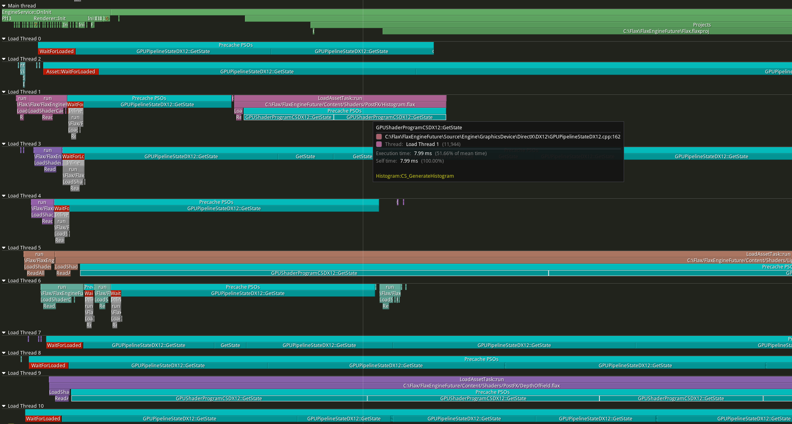

# PSO Precaching



Pipeline State Objects (PSOs) describe the GPU state required to execute a draw or dispatch. On Vulkan and DirectX 12, creating a PSO can require the graphics driver to compile and optimize shader code. That work is often performed synchronously the first time a material, render pass, or compute shader is used.

## PSO hitches

A game can run at its target frame rate and still hitch when it reaches a new area, loads a model, or enables a rendering feature for the first time. The render thread requests a PSO that is not available in the engine or driver cache, and the backend must create it before the draw can continue. The resulting CPU stall appears as a frame-time spike rather than as a normal shader compilation error.

PSO hitches are especially noticeable on Vulkan and DirectX 12 because the application is responsible for creating explicit pipeline state. A shader cache or a previously stored pipeline library can reduce the cost on later runs, but it does not guarantee that every PSO needed by the current level and render-target configuration is already available.

## How PSO precaching solves it

Flax can predict potentially needed PSOs and create them asynchronously before the corresponding draw call. Precaching is enabled for the graphics backends that support this workflow, including Vulkan and DirectX 12. It is split into the following sources:

- **Shaders**: compute shader pipelines are precached when shader assets are loaded.
- **Renderer**: rendering systems precache pipelines used by lighting, post-processing, and other renderer passes.
- **Level**: visual actors, models, materials, and their vertex layouts precache the combinations required by the level.

The engine submits precache work in asynchronous jobs (uses Content Loading threads). Related material and draw-pass requests are batched to avoid creating a separate task for every object. The precache request includes the dynamic information that is part of the final PSO, such as vertex layouts, render-target formats, depth format, and multisampling settings.

When a render path later looks up a PSO, the precached result is reused instead of being compiled on the render path. If the requested combination was not precached, the engine records a miss and creates the PSO as needed. This can still produce a hitch, so a miss is useful profiling information: it usually means that a material, vertex layout, render-pass layout, or render-target configuration was not included in the precache request.

During development, a PSO miss can either wait for the PSO to become ready or skip the draw until it is ready, depending on the active miss-handling mode. Waiting preserves the image but can cause a hitch; skipping avoids the stall but can temporarily omit the affected draw. Release builds should be tested with the same content and render paths used by the final game so that missing precache cases are found before shipping (`GPUPipelineCache::MissModes` controls this logic).

## Profiling PSO hitches

`GPUDevice.DumpPSOs` is a development debug command that writes PSO statistics to the log. It is available when PSO precaching is compiled in and is intended for profiling Vulkan and DirectX 12 rendering.

Run the command after reproducing the traversal, level load, or gameplay sequence that contains the hitch. Compare the output before and after the sequence. It reports:

- PSO precaching time and its aggregate statistics.
- The number of asynchronous precache jobs, batch jobs, and material jobs.
- PSO lookup time and the number of lookup misses.
- PSO hitch time statistics. A lookup taking more than 5 ms is counted as a hitch by the development instrumentation.

A useful profiling workflow is:

1. Start a `Development` or `Debug` build on a target platform with `-gpudebug` command line.
2. Reproduce the hitch once, including the same camera movement and gameplay actions.
3. Run `GPUDevice.DumpPSOs` from the in-game console or debug command interface.
4. Check **GPU PSO lookup stats**, **Misses**, and **GPU PSO hitch stats** in the log.
5. If misses remain, inspect the first affected asset or render path and ensure its material options, vertex layout, and render-target/depth configuration are represented by precaching.
6. Repeat the same sequence after the precache path is corrected and verify that lookup misses and hitch time decrease.

The command reports accumulated counters for the current process. Start a new run when comparing independent measurements. `DumpPSOs` is not a GPU frame profiler; it measures the CPU-side PSO lookup and creation work that can block rendering.

When diagnosing a suspected precaching mismatch, run with GPU debug logging enabled (`-gpudebug`). In development builds, Vulkan and DirectX 12 can then report cases where a requested PSO differs from a precached one, such as a wrong vertex layout or render-pass/render-target format. Those messages identify the dynamic part that must be added to the precache coverage.

## Testing from an empty cache with `-gpuclear`

Use the `-gpuclear` command-line argument to clear GPU shader and pipeline caches during graphics initialization. This provides a controlled cold-cache run instead of accidentally measuring a warm driver cache.

For Vulkan and DirectX 12 on Windows, the cleanup includes the engine's Vulkan pipeline cache and validation cache, the DirectX 12 pipeline library cache, the Windows D3D shader cache, and relevant vendor driver cache directories. In the editor, the editor shader cache is also cleared. The argument does not disable PSO precaching; it removes persisted cache data so that the effect of precaching can be measured from a clean state - just like it might work for a first-time launch for players.

Example:

```text
FlaxGame.exe -gpuclear -gpudebug -d3d12
```

Use `-gpuclear` sparingly. The first run after clearing caches is expected to do more work, and later runs may be faster because the driver has repopulated its cache. For a meaningful comparison, record `DumpPSOs` output from a cold-cache run, then repeat the same sequence without `-gpuclear` and compare both the PSO statistics and frame-time captures.

On Windows builds, Flax can also clear caches automatically when the configured shader-cache version changes after an engine or game update. This prevents incompatible persisted cache data from being treated as a valid warm cache. Simply increment `Shader Cache Version` properly in [Windows Settings](../../platforms/windows.md) each time game receives an important update.

## Limitations

PSO precaching only helps when the engine can anticipate the exact pipeline combination. New material permutations, uncommon vertex layouts, render-target changes, and paths reached only by particular gameplay states may still generate a miss. Treat `DumpPSOs` results and `-gpudebug` mismatch messages as a checklist for expanding precache coverage, and profile on the target GPU and driver because PSO creation cost varies between vendors.
