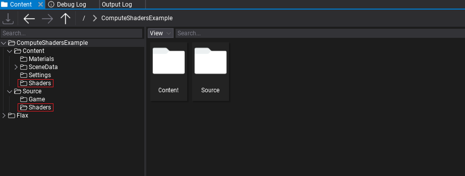
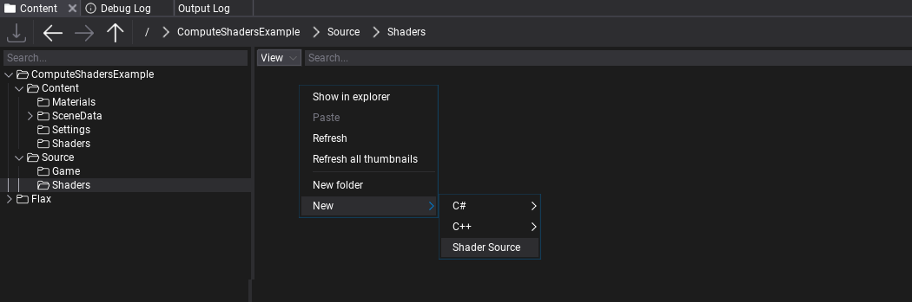
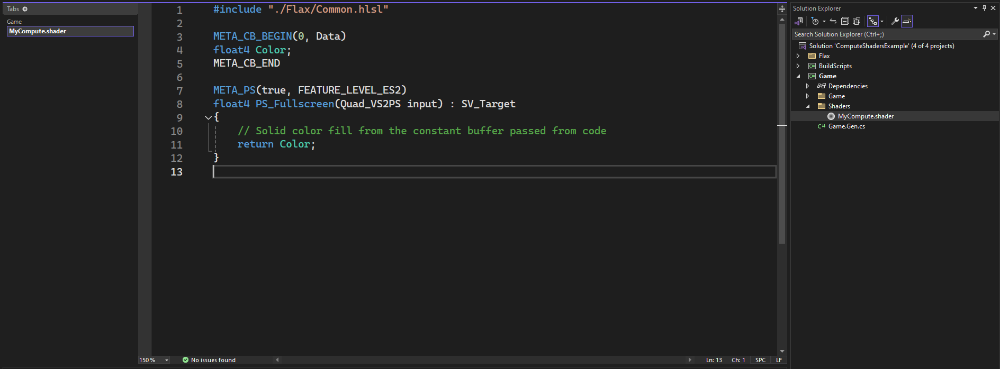

# Compute Shader

Compute shaders are GPU programs that don't use classical GPU pipeline such as vertex transformations,fragment shading or MSAA.<br>
Dispatch submits GPU work; it does not wait for completion. Asynchronous compute on a separate GPU queue is a different feature and is not implied by using a compute shader.<br>
They can be used for massively parallel computational algorithms, or to accelerate parts of game rendering.<br>
Compute shaders don't need vertex/index buffers and don't write to output render target directly but instead can read and write to arbitrary buffers and textures provided by the user.


## About the Ways to run compute shaders
compute shaders can be run in multiple ways in Flax

| using                    | usage                                                                                                                          |
|--------------------------|--------------------------------------------------------------------------------------------------------------------------------|
| Post processing effect   | running effects with can't be done with normal full screen shader's                                                            |
| Rendering task           | submitting compute from an enabled render task callback, with explicit task ordering                                              |
| main GPUContext          | the context used to record GPU commands; use it from an engine rendering callback, not an arbitrary worker |

> [!IMPORTANT]
> Use the GPUContext supplied to a rendering callback. Do not move main-context commands to Task.Run. Dispatch returning does not mean the GPU has finished.

## Create Compute new shader source

First, folders in **Source** and **Content** named **Shaders**<br>



Then go to **Source/Shaders** Folder and *right-click* in Content window shaders source folder **New -> Source Shader**.<br>



and name it for example. `MyComputeShader.shader`.

If you're working with Visual Studio then use **File -> Generate project file** option to ensure new file was added to VS project.<br>
Then you can **double-click** to open shader in code editor.

you should see the shader under `Game/Shaders/MyComputeShader.shader`



By default flax new shader source generates code for Fullscreen Shader
we need to change it

```hlsl
#include "./Flax/Common.hlsl"

META_CB_BEGIN(0, Data)
float4 Color;
META_CB_END

META_CS(true, FEATURE_LEVEL_SM5)
[numthreads(1, 1, 1)]
void CS_Main(uint3 dispatchThreadID : SV_DispatchThreadID, uint3 groupID : SV_GroupID, uint3 groupThreadID : SV_GroupThreadID)
{

}
```
### About the parameters
*what is the SV_DispatchThreadID,SV_GroupID,SV_GroupThreadID ?*<br>
information about the parameters can be found in microsoft documentation<br>
1. [SV_GroupID](https://learn.microsoft.com/en-us/windows/win32/direct3dhlsl/sv-groupid)
2. [SV_GroupThreadID](https://learn.microsoft.com/en-us/windows/win32/direct3dhlsl/sv-groupthreadid)
3. [SV_DispatchThreadID](https://learn.microsoft.com/en-us/windows/win32/direct3dhlsl/sv-dispatchthreadid)


# API's
* [Low Level API](compute/ll-api.md)
* [High Level API](compute/hl-api.md)
