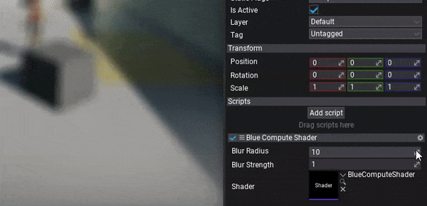

## Running compute with in Post Proccesing efect

Let's start with simple blur effect<br>

In this example we use two functions: one will blur the input image horizontally (`CS_BlurH`), second one will perform a vertical blur (`CS_BlurV`). The blur will use a configurable radius (in range 0-10) and blending intensity.

> [!NOTE]
> Follow code comments to better understand how it works.

```hlsl
#include "./Flax/Common.hlsl"

// Configuration constants (must match C#)
#define BLUR_MAX_SAMPLE_RADIUS 10
#define BLUR_GRID_SIZE 450
#define BLUR_APRON_SIZE BLUR_MAX_SAMPLE_RADIUS
#define BLUR_THREAD_GROUP_SIZE (BLUR_GRID_SIZE + (BLUR_APRON_SIZE * 2))

// Constant buffers data passed from CPU to GPU
META_CB_BEGIN(0, Data)
float2 Dummy0;
float BlurStrength;
float BlurRadius;
META_CB_END

// Input texture to blur and the output texture to write to
Texture2D Input : register(t0);
RWTexture2D<float4> Output : register(u0);

// Shared memory used by all threads in the group
groupshared float4 Samples[BLUR_THREAD_GROUP_SIZE];

// Compute shader blur function for horizontal pass
META_CS(true, FEATURE_LEVEL_SM5)
[numthreads(BLUR_THREAD_GROUP_SIZE, 1, 1)]
void CS_BlurH(uint3 groupID : SV_GroupID, uint3 groupThreadID : SV_GroupThreadID)
{
	// These positions are relative to the "grid", AKA the horizontal group of pixels that this thread group is writing to
	const int2 gridStartXY = groupID.xy * BLUR_GRID_SIZE;
	const int2 gridXY = int2(groupThreadID.xy) - BLUR_APRON_SIZE;

	// These positions are relative to the pixel coordinates
	const int sampleX = gridStartXY.x + gridXY.x;
	const int sampleY = groupID.y;
	const int groupIndex = groupThreadID.x;

	uint2 textureSize;
	Input.GetDimensions(textureSize.x, textureSize.y);
	const int2 samplePos = int2(sampleX, sampleY);

	// Sample the texture
	float2 sampleCoord = saturate(((float2)samplePos + 0.5f) / float2(textureSize));
	float4 color = Input.SampleLevel(SamplerPointClamp, sampleCoord, 0.0f);

	// Store in shared memory and sync threads
	Samples[groupIndex] = color;
	GroupMemoryBarrierWithGroupSync();

	// Don't continue for threads in the apron, and threads outside the render target size
	if (gridXY.x >= 0 && gridXY.x < BLUR_GRID_SIZE && sampleX < textureSize.x)
	{
		float4 outputColor = 0.0f;
		float totalContribution = 0.0f;

		// Gather sample taps inside the radius
		for (int i = -BLUR_MAX_SAMPLE_RADIUS; i <= BLUR_MAX_SAMPLE_RADIUS; i++)
		{
			// Grab the sample from shared memory
			float4 tap = Samples[groupIndex + i];

			// Reject the sample if it's outside the CoC radius
			float tapWeight = saturate(BlurRadius + 1.0f - abs(float(i)));

			outputColor += tap * tapWeight;
			totalContribution += tapWeight;
		}

		// Write out the result
		outputColor /= totalContribution;
		outputColor = max(outputColor, 0);
		outputColor = lerp(color, outputColor, BlurStrength);
		Output[samplePos] = outputColor;
	}
}

// Compute shader blur function for vertical pass
META_CS(true, FEATURE_LEVEL_SM5)
[numthreads(1, BLUR_THREAD_GROUP_SIZE, 1)]
void CS_BlurV(uint3 groupID : SV_GroupID, uint3 groupThreadID : SV_GroupThreadID)
{
	// These positions are relative to the "grid", AKA the horizontal group of pixels that this thread group is writing to
	const int2 gridStartXY = groupID.xy * BLUR_GRID_SIZE;
	const int2 gridXY = int2(groupThreadID.xy) - BLUR_APRON_SIZE;

	// These positions are relative to the pixel coordinates
	const int sampleX = groupID.x;
	const int sampleY = gridStartXY.y + gridXY.y;
	const int groupIndex = groupThreadID.y;

	uint2 textureSize;
	Input.GetDimensions(textureSize.x, textureSize.y);
	const int2 samplePos = int2(sampleX, sampleY);

	// Sample the texture
	float2 sampleCoord = saturate(((float2)samplePos + 0.5f) / float2(textureSize));
	float4 color = Input.SampleLevel(SamplerPointClamp, sampleCoord, 0.0f);

	// Store in shared memory and sync threads
	Samples[groupIndex] = color;
	GroupMemoryBarrierWithGroupSync();

	// Don't continue for threads in the apron, and threads outside the render target size
	if (gridXY.y >= 0 && gridXY.y < BLUR_GRID_SIZE && sampleY < textureSize.y)
	{
		float4 outputColor = 0.0f;
		float totalContribution = 0.0f;

		// Gather sample taps inside the radius
		for (int i = -BLUR_MAX_SAMPLE_RADIUS; i <= BLUR_MAX_SAMPLE_RADIUS; i++)
		{
			// Grab the sample from shared memory
			float4 tap = Samples[groupIndex + i];

			// Reject the sample if it's outside the CoC radius
			float tapWeight = saturate(BlurRadius + 1.0f - abs(float(i)));

			outputColor += tap * tapWeight;
			totalContribution += tapWeight;
		}

		// Write out the result
		outputColor /= totalContribution;
		outputColor = max(outputColor, 0);
		outputColor = lerp(color, outputColor, BlurStrength);
		Output[samplePos] = outputColor;
	}
}

```

## Dispatching compute

Next step is to write a script that will invoke the compute shader execution on a GPU. To do so we will use a C# script that implements **PostProcessEffect** class which is used to inject custom rendering code into the in-built graphics pipeline. You can also override the *Order* and *Location* properties to have even more control over rendering.

Create C# script and add it to the any actor on the scene. You can use [this tutorial](../../../scripting/new-script.md) to learn how to do it. Then, write the following code:

```cs
using System;
using System.Runtime.InteropServices;
using FlaxEngine;

public class BlurComputeShader : PostProcessEffect
{
    /// <summary>
    /// Shader constant buffer data structure that matches the HLSL source.
    /// </summary>
    [StructLayout(LayoutKind.Sequential)]
    private struct Data
    {
        public Float2 Dummy0;
        public float BlurStrength;
        public float BlurRadius;
    }

    [Tooltip("Blur effect intensity (0-1)"), Limit(0, 1.0f, 0.01f)]
    public float BlurStrength = 1.0f;

    [Tooltip("Blur effect radius (0-10)"), Limit(0, 10.0f, 0.1f)]
    public float BlurRadius = 10.0f;

    private bool _isComputeSupported;
    private MainRenderTask _task;

    public Shader Shader;

    public override void OnEnable()
    {
        _isComputeSupported = GPUDevice.Instance.Limits.HasCompute;

        // Register postFx to game view
        _task = MainRenderTask.Instance;
        _task?.AddCustomPostFx(this);
    }

    public override void OnDisable()
    {
        // Remember to unregister from drawing
        _task?.RemoveCustomPostFx(this);
        _task = null;
    }

    public override bool CanRender()
    {
        return base.CanRender() && _isComputeSupported && Shader && Shader.IsLoaded;
    }

    public override unsafe void Render(GPUContext context, ref RenderContext renderContext, GPUTexture input, GPUTexture output)
    {
        // Here we perform custom rendering on top of the in-build drawing

        // Set constant buffer data (memory copy is used under the hood to copy raw data from CPU to GPU memory)
        var cb = Shader.GPU.GetCB(0);
        if (cb != IntPtr.Zero)
        {
            var data = new Data
            {
                BlurStrength = Mathf.Clamp(BlurStrength, 0.0f, 1.0f),
                BlurRadius = Mathf.Clamp(BlurRadius, 0.0f, 10.0f),
            };
            context.UpdateCB(cb, new IntPtr(&data));
        }

        // Allocate temporary textures for blurring
        var desc = input.Description;
        desc.Flags = GPUTextureFlags.UnorderedAccess | GPUTextureFlags.ShaderResource | GPUTextureFlags.RenderTarget;
        var blurH = RenderTargetPool.Get(ref desc);
        var blurV = RenderTargetPool.Get(ref desc);

        // Configuration constants (must match HLSL)
        const int BLUR_GRID_SIZE = 450;

        // Dispatch the Compute Shader to blur input image horizontally to blurH
        context.BindCB(0, cb);
        context.BindSR(0, input);
        context.BindUA(0, blurH.View());
        var csBlurH = Shader.GPU.GetCS("CS_BlurH");
        int groupCountX = (desc.Width / BLUR_GRID_SIZE) + ((desc.Width % BLUR_GRID_SIZE) > 0 ? 1 : 0);
        int groupCountY = desc.Height;
        context.Dispatch(csBlurH, (uint) groupCountX, (uint) groupCountY, 1);

        // Clean slots
        context.ResetUA();
        context.ResetSR();

        // Dispatch the Compute Shader to blur blurH image vertically to blurV
        context.BindCB(0, cb);
        context.BindSR(0, blurH);
        context.BindUA(0, blurV.View());
        var csBlurV = Shader.GPU.GetCS("CS_BlurV");
        groupCountX = desc.Width;
        groupCountY = (desc.Height / BLUR_GRID_SIZE) + ((desc.Height % BLUR_GRID_SIZE) > 0 ? 1 : 0);
        context.Dispatch(csBlurV, (uint) groupCountX, (uint) groupCountY, 1);

        // Clean slots
        context.ResetUA();
        context.ResetSR();

        // Copy blurred image to the output
        context.Draw(output, blurV);

        RenderTargetPool.Release(blurH);
        RenderTargetPool.Release(blurV);
    }
}
```

> [!NOTE]
> This blur sample still needs format-capability checks and exception-safe release of pooled targets before production use. Do not assume the input format supports UAV writes. The two dispatches are separate passes; binding resets are not CPU/GPU completion fences. The constant-buffer data occupies 16 bytes.

## See results

The final step is to **add script** to actor on scene and **assign Shader** property to the auto-imported shader source from `Content/Shaders`.  When changing **Blur Radius** property from 0 to 10 you can see the effect in action real-time. In case of problems see *Output Log* window in Editor as it may contain any compilation errors (for both C# script and shader code).

