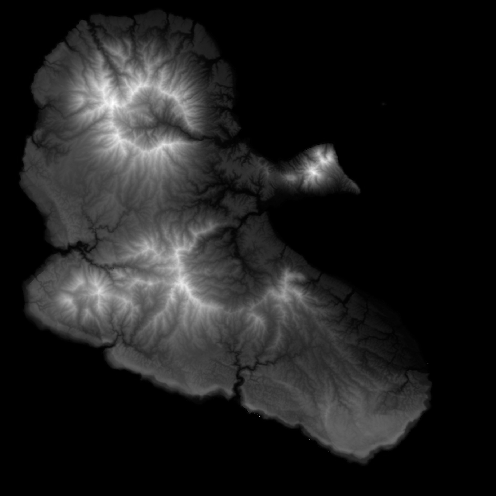
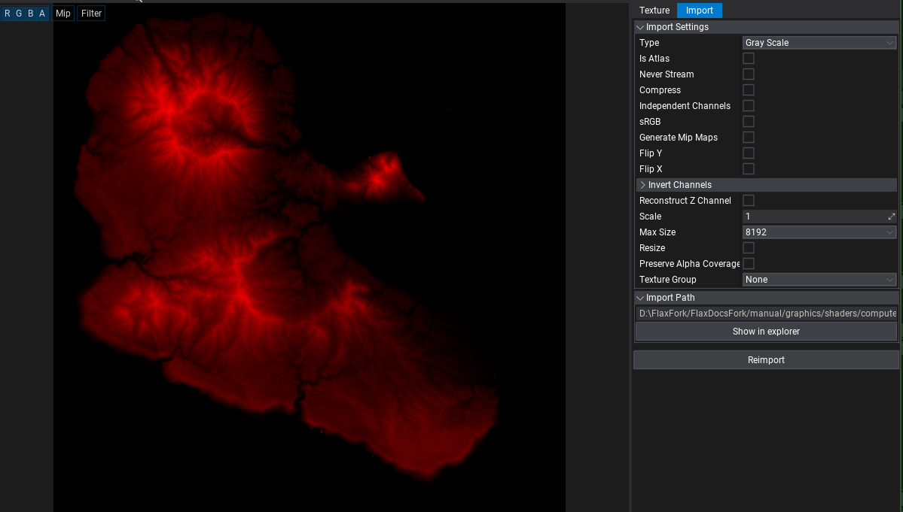
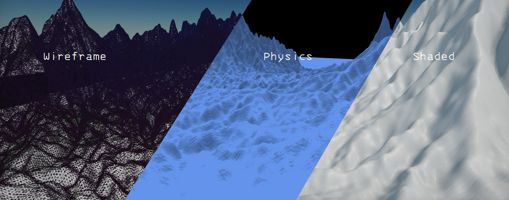

# Running compute with Render Task

As introduced in [Compute Shader](../compute-shader.md), a render task lets us submit compute work from the engine render loop. Here we will use one to generate terrain from a height map, read the results back, and build a visible mesh and a physics collider.

## About render task
A RenderTask provides Begin, Render and End callbacks in the render loop. We will use them in this order:

1. **Begin:** update constants and bind the height map and output buffers.
2. **Render:** pick the compute program and dispatch it.
3. **End:** clear bindings, read the results and update the mesh.

These callbacks describe CPU-side command submission. End does not mean the GPU has finished; mapping the readback buffers below can wait for it.

### Creating Render Task

We will build one `MyComputeShaderWithRenderTask` class in stages. The initial code creates and subscribes the task; later sections add its callbacks and helper methods. Blocks containing `...` show additions to the same class, not separate scripts. The class is complete only after all stages have been added.

## Compute Example
Let’s roll the wheel of fortune… a texture example? We can do more than that :D We will generate a grid mesh from a height map, then use the generated data for rendering and collision.

The shader uses a **constant buffer** for grid dimensions, a **`Texture2D<float4>`** for heights, **`RWStructuredBuffer<float3>`** outputs for positions and normals, and an **`RWBuffer<int>`** for triangle indices.

> [!IMPORTANT]
> Before we start i need to clarify something <br>
> we will do something stupid in this example it is not optimal <br>
> reading large amount data back to CPU is expensive <br>

> [!IMPORTANT]
> we will not get in to resizing the buffers and the data
> the buffer size will be constant

Choose a grayscale height map. You can paint your own or use either image below. Start with the 32×32 image to check the setup before trying the island.

### Some random island (size of 1872x1872)

### small texture (size of 32x32)


## Before we start this is IMPORTANT !!
This example generates a dense mesh: **one vertex per image pixel**. The island example was tested on:

- AMD Ryzen 7 8700G
- NVIDIA GeForce RTX 3050, 8 GB VRAM
- 32 GB RAM

Rendering the generated mesh dropped performance from roughly 400 FPS to 60 FPS on that setup.
Start with a small texture, especially on slower hardware. it is not a “1 way to crash PC” doc :|

A 32-by-32 group contains 1024 threads.
Verify device limits, or change both shader group dimensions and C# dispatch division.
The example readback below maps staging buffers immediately after copying; this can stall CPU submission while the GPU completes.
It is a synchronous correctness example, not streaming or asynchronous readback.


This example reads the generated mesh back to the CPU and updates a StaticModel and collision data, StaticModel’s use normal rendering path,
including occlusion culling and shadow rendering.
Direct GPU drawing does not automatically participate in those systems, so we leave that integration outside this example.

This example follows that Model/StaticModel path throughout. Direct custom drawing is a separate topic; see [Custom Geometry Drawing](../custom-geometry-drawing.md).

Mesh size is limited by available memory, buffer sizes and index format.
A dense height map grows quickly: width × height vertices and (width − 1) × (height − 1) × 6 indices.
This example uses 32-bit indices


## Let’s do it slowly so the setup makes sense
Because Flax doesn’t have a [high-level compute API](../compute/hl-api.md) yet, brace yourself, there’s a fair bit of code ahead.

Each output needs a buffer pair: one writable GPU buffer and one CPU-readable staging buffer.
We need three pairs, for positions, normals and triangle indices.
The staging buffers let us read the results without trying to map the shader outputs directly.

The two helpers below belong inside the script class. `CreateBufferPair` returns true on success; the underlying `GPUBuffer.Init` uses the opposite convention, returning true on failure. `ReleaseBuffer` destroys an owned buffer and clears its reference.
```csharp
...
public class MyComputeShaderWithRenderTask : Script
{
    ...

    private bool CreateBufferPair(
        GPUBufferDescription gpuDescription,
        out GPUBuffer gpuBuffer,
        out GPUBuffer readbackBuffer)
    {
        gpuBuffer = new GPUBuffer();
        readbackBuffer = null;

        if (gpuBuffer.Init(ref gpuDescription))
        {
            Debug.LogError("Failed to create GPU output buffer.");
            FlaxEngine.Object.Destroy(gpuBuffer);
            gpuBuffer = null;
            return false;
        }

        // The helper configures a CPU-readable staging buffer.
        GPUBufferDescription stagingDescription =
            gpuDescription.ToStagingReadback();

        // Do not assign InitData to a staging readback buffer.
        readbackBuffer = new GPUBuffer();

        if (readbackBuffer.Init(ref stagingDescription))
        {
            Debug.LogError("Failed to create staging readback buffer.");

            FlaxEngine.Object.Destroy(readbackBuffer);
            readbackBuffer = null;
            FlaxEngine.Object.Destroy(gpuBuffer);
            gpuBuffer = null;
            return false;
        }

        return true;
    }
    private void ReleaseBuffers()
    {
        ReleaseBuffer(ref TrianglesReadback);
        ReleaseBuffer(ref TrianglesGPUBuffer);
        ReleaseBuffer(ref VertexesReadback);
        ReleaseBuffer(ref VertexesGPUBuffer);
        ReleaseBuffer(ref NormalsReadback);
        ReleaseBuffer(ref NormalsGPUBuffer);
    }

    private static void ReleaseBuffer(ref GPUBuffer buffer)
    {
        if (buffer == null)
            return;

        FlaxEngine.Object.Destroy(buffer);
        buffer = null;
    }

    ...
}
```


### Creation and destruction of buffers

GPU buffers must be released when they are no longer needed, when their owner is destroyed, or when they are replaced during resizing.
Make **sure** pending GPU work has finished using them before releasing them.

Before we dig into the code, check whether the active graphics device supports compute shaders. Some devices or graphics backends don’t support them, and servers may run without a GPU at all.

Check compute support before creating resources or dispatching work. If it is unavailable, disable the feature, use a CPU fallback, or stop startup with a clear error if compute is required. Avoid forcing the whole application to close for an optional feature.

```csharp
if (GPUDevice.Instance == null || !GPUDevice.Instance.Limits.HasCompute)
{
    Debug.LogError("This feature requires GPU compute support.");
    return; // Skip initialization, or select a CPU fallback here.
}
```

#### Initial C# code

Start with the fields, initialization and destruction code below, and add the buffer helpers above inside the class. `OnBegin`, `OnRender` and `OnEnd` are supplied in the following chapters.

The input assets must already be loaded when this example starts.
The script reports an error rather than waiting for them. Use the same world transform for the script’s host actor and the assigned StaticModel: the generated collider is a child of the host, while the visible mesh belongs to StaticModel.

```csharp
using System;
using System.Runtime.CompilerServices;
using System.Runtime.InteropServices;
using FlaxEngine;

public class MyComputeShaderWithRenderTask : Script
{
    public Shader shader;
    public Texture HeightMap;
    public StaticModel staticModel;
    private MeshCollider collider;
    private RenderTask MyComputeRenderTask;

    private Int2 Size;

    private GPUBuffer TrianglesGPUBuffer;
    private GPUBuffer TrianglesReadback;

    private GPUBuffer VertexesGPUBuffer;
    private GPUBuffer VertexesReadback;

    private GPUBuffer NormalsGPUBuffer;
    private GPUBuffer NormalsReadback;

    Float3[] VertexesBuffer;
    Float3[] NormalsBuffer;
    int[] TrianglesBuffer;

    public bool computeDispatched;
    public bool computeCompleted;
    public bool initialized;

    public bool RunCompute
    {
        get => MyComputeRenderTask != null && MyComputeRenderTask.Enabled;
        set
        {
            if (value && MyComputeRenderTask != null && computeCompleted)
            {
                computeDispatched = false;
                computeCompleted = false;
                MyComputeRenderTask.Enabled = true;
            }
        }
    }

    public override void OnStart()
    {
        if (GPUDevice.Instance == null || !GPUDevice.Instance.Limits.HasCompute)
        {
            Debug.LogError("GPU compute shaders are not supported.");
            return;
        }

        if (shader == null || HeightMap == null || staticModel == null)
        {
            Debug.LogError(
                "Assign Shader, HeightMap, and StaticModel in the Inspector.");
            return;
        }

        if (!shader.IsLoaded || !HeightMap.IsLoaded)
        {
            Debug.LogError("Wait for Shader and HeightMap to load before starting this example.");
            return;
        }

        if (HeightMap.Width < 2 || HeightMap.Height < 2)
        {
            Debug.LogError("Heightmap must be at least 2x2 pixels.");
            return;
        }

        // Size represents the number of grid cells, not vertices.
        Size = new Int2(HeightMap.Width - 1, HeightMap.Height - 1);

        int vertexCount = checked((Size.X + 1) * (Size.Y + 1));
        int triangleIndexCount = checked(Size.X * Size.Y * 6);

        VertexesBuffer = new Float3[vertexCount];
        NormalsBuffer = new Float3[vertexCount];
        TrianglesBuffer = new int[triangleIndexCount];

        // Create a virtual model for the generated mesh.
        Model model = Content.CreateVirtualAsset<Model>();
        // create collider
        collider = Actor.AddChild<MeshCollider>();
        collider.CollisionData = Content.CreateVirtualAsset<CollisionData>();
        model.SetupLODs([1]);
        staticModel.Model = model;

        uint vertexStride = (uint)Unsafe.SizeOf<Float3>();

        GPUBufferDescription vertexDescription = new GPUBufferDescription
        {
            Format = PixelFormat.Unknown,
            Usage = GPUResourceUsage.Default,
            Flags = GPUBufferFlags.UnorderedAccess |
                    GPUBufferFlags.Structured,
            Stride = vertexStride,
            Size = (uint)vertexCount * vertexStride,
            InitData = IntPtr.Zero
        };

        GPUBufferDescription triangleDescription = new GPUBufferDescription
        {
            Format = PixelFormat.R32_SInt,
            Usage = GPUResourceUsage.Default,
            Flags = GPUBufferFlags.UnorderedAccess,
            Stride = sizeof(int),
            Size = (uint)triangleIndexCount * sizeof(int),
            InitData = IntPtr.Zero
        };

        if (!CreateBufferPair(
                vertexDescription,
                out VertexesGPUBuffer,
                out VertexesReadback))
        {
            ReleaseBuffers();
            return;
        }

        if (!CreateBufferPair(
                vertexDescription,
                out NormalsGPUBuffer,
                out NormalsReadback))
        {
            ReleaseBuffers();
            return;
        }

        if (!CreateBufferPair(
                triangleDescription,
                out TrianglesGPUBuffer,
                out TrianglesReadback))
        {
            ReleaseBuffers();
            return;
        }

        MyComputeRenderTask = new RenderTask();
        MyComputeRenderTask.Begin += OnBegin;
        MyComputeRenderTask.Render += OnRender;
        MyComputeRenderTask.End += OnEnd;

        initialized = true;

        Debug.Log(
            $"Terrain compute initialized: {HeightMap.Width}x{HeightMap.Height}, " +
            $"{vertexCount} vertices, {triangleIndexCount / 3} triangles.");
    }

    ... // Buffer helpers and render callbacks are shown in their own sections.

    public override void OnDestroy()
    {
        if (MyComputeRenderTask != null)
        {
            MyComputeRenderTask.Begin -= OnBegin;
            MyComputeRenderTask.Render -= OnRender;
            MyComputeRenderTask.End -= OnEnd;

            DestroyNow(MyComputeRenderTask);
            MyComputeRenderTask = null;
        }

        ReleaseBuffer(ref TrianglesReadback);
        ReleaseBuffer(ref TrianglesGPUBuffer);

        ReleaseBuffer(ref VertexesReadback);
        ReleaseBuffer(ref VertexesGPUBuffer);

        ReleaseBuffer(ref NormalsReadback);
        ReleaseBuffer(ref NormalsGPUBuffer);
        initialized = false;
    }
}
```

The shader must provide CS_Main with `[numthreads(32, 32, 1)]`, a 16-byte constant buffer at b0 beginning with `int2 Size`, the height-map SRV at t0, and output UAVs at u0 (R32_SInt indices), u1 (structured float3 positions) and u2 (structured float3 normals).
Size counts cells; there are width-by-height vertices and `(width-1)*(height-1)*6` indices. Extra threads must bounds-check before any resource access.

#### Full shader

Save this as a shader source under `Source/Shaders`. 
Each thread writes one vertex and its normal, plus six indices when there is a grid cell at that position. 
The height correction blends the centre sample with its four diagonal neighbor's, normals are calculated from the same corrected surface.
No thread reads another thread’s output, so this kernel needs no group barrier.

```hlsl
#include "./Flax/Common.hlsl"

META_CB_BEGIN(0, Data)
int2 Size; // Cell count: height-map dimensions minus one
META_CB_END

Texture2D<float4> HeightMap          : register(t0);
RWBuffer<int> triangles              : register(u0);
RWStructuredBuffer<float3> vertexes : register(u1);
RWStructuredBuffer<float3> normals  : register(u2);

float GetHeight(int2 pixel)
{
    pixel = clamp(pixel, int2(0, 0), Size);
    return HeightMap.Load(int3(pixel, 0)).r * 255.0;
}

float GetCorrectedHeight(int2 pixel)
{
    // A B C
    // D E F
    // G H I
    float a = GetHeight(pixel + int2(-1, -1));
    float c = GetHeight(pixel + int2( 1, -1));
    float g = GetHeight(pixel + int2(-1,  1));
    float i = GetHeight(pixel + int2( 1,  1));
    float e = GetHeight(pixel);

    float surfaceHeight = (a + c + g + i) * 0.25;
    return lerp(e, surfaceHeight, 0.75);
}

float3 GetPosition(int2 pixel)
{
    return float3(pixel.x, GetCorrectedHeight(pixel), pixel.y);
}

META_CS(true, FEATURE_LEVEL_SM5)
[numthreads(32, 32, 1)]
void CS_Main(uint3 dispatchThreadID : SV_DispatchThreadID)
{
    int2 pixel = int2(dispatchThreadID.xy);
    if (any(pixel > Size))
        return;

    int width = Size.x + 1;
    int vertexID = pixel.y * width + pixel.x;

    vertexes[vertexID] = GetPosition(pixel);

    // Derive normals from the same corrected height surface.
    // No reads from other threads' output buffers are needed.
    int2 left  = int2(max(pixel.x - 1, 0), pixel.y);
    int2 right = int2(min(pixel.x + 1, Size.x), pixel.y);
    int2 back  = int2(pixel.x, max(pixel.y - 1, 0));
    int2 front = int2(pixel.x, min(pixel.y + 1, Size.y));

    float3 tangentX = GetPosition(right) - GetPosition(left);
    float3 tangentZ = GetPosition(front) - GetPosition(back);

    normals[vertexID] = normalize(cross(tangentZ, tangentX));

    // Boundary vertices have no cell starting at their position.
    if (any(pixel >= Size))
        return;

    int triangleID = (pixel.y * Size.x + pixel.x) * 6;

    int topLeft     = vertexID;
    int topRight    = vertexID + 1;
    int bottomLeft  = vertexID + width;
    int bottomRight = vertexID + width + 1;

    triangles[triangleID + 0] = topLeft;
    triangles[triangleID + 1] = bottomLeft;
    triangles[triangleID + 2] = topRight;

    triangles[triangleID + 3] = topRight;
    triangles[triangleID + 4] = bottomLeft;
    triangles[triangleID + 5] = bottomRight;
}
```

Once the shader is imported, assign these script fields:

- **shader:** the imported Shader asset.
- **staticModel:** the StaticModel actor that will display the generated model.
- **HeightMap:** the height-map Texture asset.

#### Important
Import the height map as linear data, without sRGB conversion or lossy compression. 
Otherwise the sampled heights can have stepping artifacts.

Import settings:



Colour-texture defaults such as sRGB conversion and compression are not desired for height data.

### Task control

A render task is an owned engine object, not a callback that disappears when the script is disabled. Add these methods to pause it when the script is disabled and resume unfinished work when enabled. `OnDestroy` in the initial code unsubscribes and destroys the task. Setting `RunCompute` to true requests another run after successful completion.

```csharp
...
public class MyComputeShaderWithRenderTask : Script
{
    ...
    public override void OnEnable()
    {
        if (MyComputeRenderTask != null)
            MyComputeRenderTask.Enabled = !computeCompleted;
    }

    public override void OnDisable()
    {
        if (MyComputeRenderTask != null)
            MyComputeRenderTask.Enabled = false;
    }
    ...
}
```

### Shader Resources and Unordered Access buffers bindings

`context.BindSR` binds a shader resource view (SRV) to a `t` register. HLSL resources such as `Texture2D<T>`, `Buffer<T>`, `StructuredBuffer<T>` and `ByteAddressBuffer` use these bindings.

For example, `context.BindSR(0, resource.View())` supplies the resource declared at `register(t0)`.

See Microsoft’s [HLSL resource binding documentation](https://learn.microsoft.com/en-us/windows/win32/direct3d12/resource-binding-in-hlsl).

`context.BindUA` binds an unordered access view (UAV) to a `u` register.
Writable HLSL resources such as `RWTexture2D<T>`, `RWBuffer<T>`, `RWStructuredBuffer<T>` and `RWByteAddressBuffer` use these bindings.

For example, `context.BindUA(0, resource.View())` supplies the resource declared at `register(u0)`.

See Microsoft’s [HLSL resource binding documentation](https://learn.microsoft.com/en-us/windows/win32/direct3d12/resource-binding-in-hlsl).

Here the height map is **t0**, triangle indices are **u0**, positions are **u1**, and normals are **u2**. `ComputeData` supplies **b0**.
Its 16-byte storage matches constant-buffer alignment, the unused bytes are initialized to zero.
The stack-local data remains valid for `UpdateCB` to copy during the call.

Add this structure and the Begin callback inside the class:

```csharp
...
public class MyComputeShaderWithRenderTask : Script
{
    ...
    [StructLayout(LayoutKind.Sequential, Size = 16)]
    private struct ComputeData
    {
        public Int2 Size;
    }

    private unsafe void OnBegin(RenderTask task, GPUContext context)
    {
        if (computeCompleted)
            return;
        if (shader.GPU.GetCB(0) == IntPtr.Zero)
        {
            task.Enabled = false;
            return;
        }

        // Bind the heightmap and output UAVs.
        context.BindSR(0, HeightMap.Texture.View());

        context.BindUA(0, TrianglesGPUBuffer.View());
        context.BindUA(1, VertexesGPUBuffer.View());
        context.BindUA(2, NormalsGPUBuffer.View());

        // Update the shader's Size constant buffer.
        IntPtr constantBuffer = shader.GPU.GetCB(0);

        if (constantBuffer != IntPtr.Zero)
        {
            var data = new ComputeData { Size = Size };
            context.UpdateCB(constantBuffer, (IntPtr)(&data));
        }

        context.BindCB(0, constantBuffer);
    }
    ...
}
```

### Dispatch compute and program picker

This example uses one `context.Dispatch` and one entry point, `CS_Main`. `GetCS` selects that program from the loaded shader, a zero result means it was not found.

Dispatch dimensions count **thread groups**, not vertices. 
Dividing the texture dimensions by 32 and rounding up covers every vertex.
The shader checks bounds for extra threads in the last groups.

Dispatches can be chained, but dependent passes must run in order, with the required resource synchronization between writes and reads.
Resetting bindings alone does not prove completion, the graphics backend must handle the necessary barriers.

A larger terrain generator could use separate programs for:

- Basic mesh generation.
- Erosion.
- Populating terrain based on slope.

Here we only dispatch the first stage. Keep `32` in the C# group calculation synchronized with `[numthreads(32, 32, 1)]` in HLSL.

```csharp
...
public class MyComputeShaderWithRenderTask : Script
{
    ...
    private void OnRender(RenderTask task, GPUContext context)
    {
        if (computeDispatched || computeCompleted)
            return;

        IntPtr kernel = shader.GPU.GetCS("CS_Main");

        if (kernel == IntPtr.Zero)
        {
            Debug.LogError("Compute kernel CS_Main was not found.");
            task.Enabled = false;
            return;
        }

        // The shader uses [numthreads(32, 32, 1)].
        // Ceiling division covers dimensions not divisible by 32.
        uint groupsX = (uint)((HeightMap.Width + 31) / 32);
        uint groupsY = (uint)((HeightMap.Height + 31) / 32);

        context.Dispatch(kernel, groupsX, groupsY, 1);

        computeDispatched = true;

        Debug.Log(
            $"Terrain compute dispatched: {groupsX}x{groupsY} thread groups.");
    }
    ...
}
```

### Reading results and clearing resource bindings

Before copying the compute outputs, clear the unordered access, shader resource and constant-buffer bindings with `ResetUA()`, `ResetSR()` and `ResetCB()`. These calls clear binding state, they do not free the buffers or wait for GPU completion.

`PullData` copies each GPU output into its CPU-readable staging buffer. It then maps the staging buffers, copies their contents into managed arrays and unmaps them. Always call `Unmap()` in a `finally` block after a successful map.

> [!IMPORTANT]
> Mapping staging buffers immediately after copying can block while the GPU finishes its work. This example uses synchronous readback for simplicity.

Finally, `UpdateMesh` uploads the managed arrays into the Model’s mesh, and `CookCollision` builds triangle-mesh collision from those same positions and indices. Collision cooking is extra CPU work; this is not a GPU-only physics path. Once these steps finish, the render task is disabled so the example does not repeat the work every frame.

Add `OnEnd` and `PullData` inside the same class. Together with the earlier sections, these complete the script.

```csharp
...
public class MyComputeShaderWithRenderTask : Script
{
    ...

    private void OnEnd(RenderTask task, GPUContext context)
    {
        context.ResetUA();
        context.ResetSR();
        context.ResetCB();
        if (!computeDispatched || computeCompleted)
            return;

        if (!PullData(context))
        {
            Debug.LogError("Terrain compute readback failed.");
            task.Enabled = false;
            return;
        }

        computeCompleted = true;
        task.Enabled = false;

        Debug.Log("Terrain compute completed and mesh updated.");
    }


    private bool PullData(GPUContext context)
    {
        uint triangleBytes = checked((uint)TrianglesBuffer.Length * sizeof(int));
        uint vertexBytes = checked((uint)VertexesBuffer.Length * (uint)Unsafe.SizeOf<Float3>());
        uint normalBytes = checked((uint)NormalsBuffer.Length * (uint)Unsafe.SizeOf<Float3>());

        // Copy all outputs using the callback's context.
        context.CopyBuffer(
            TrianglesReadback,
            TrianglesGPUBuffer,
            triangleBytes);

        context.CopyBuffer(
            VertexesReadback,
            VertexesGPUBuffer,
            vertexBytes);

        context.CopyBuffer(
            NormalsReadback,
            NormalsGPUBuffer,
            normalBytes);

        // Read triangle indices.
        IntPtr pointer = TrianglesReadback.Map(GPUResourceMapMode.Read);

        if (pointer == IntPtr.Zero)
        {
            Debug.LogError("Failed to map triangle readback buffer.");
            return false;
        }

        try
        {
            Marshal.Copy(
                pointer,
                TrianglesBuffer,
                0,
                TrianglesBuffer.Length);
        }
        finally
        {
            TrianglesReadback.Unmap();
        }

        // Read vertex positions.
        pointer = VertexesReadback.Map(GPUResourceMapMode.Read);

        if (pointer == IntPtr.Zero)
        {
            Debug.LogError("Failed to map vertex readback buffer.");
            return false;
        }

        try
        {
            byte[] bytes = new byte[checked((int)vertexBytes)];

            Marshal.Copy(pointer, bytes, 0, bytes.Length);

            MemoryMarshal.Cast<byte, Float3>(bytes)
                .CopyTo(VertexesBuffer);
        }
        finally
        {
            VertexesReadback.Unmap();
        }

        // Read vertex normals.
        pointer = NormalsReadback.Map(GPUResourceMapMode.Read);

        if (pointer == IntPtr.Zero)
        {
            Debug.LogError("Failed to map normal readback buffer.");
            return false;
        }

        try
        {
            byte[] bytes = new byte[checked((int)normalBytes)];

            Marshal.Copy(pointer, bytes, 0, bytes.Length);

            MemoryMarshal.Cast<byte, Float3>(bytes)
                .CopyTo(NormalsBuffer);
        }
        finally
        {
            NormalsReadback.Unmap();
        }

        // Update the mesh using the CPU-side arrays.
        staticModel.Model.LODs[0].Meshes[0].UpdateMesh(
            VertexesBuffer,
            TrianglesBuffer,
            NormalsBuffer,
            null);
        collider.CollisionData.CookCollision(CollisionDataType.TriangleMesh, VertexesBuffer, TrianglesBuffer, ConvexMeshGenerationFlags.FastCook);

        Debug.Log(
            $"Readback successful: {VertexesBuffer.Length} vertices, " +
            $"{TrianglesBuffer.Length / 3} triangles.");

        return true;
    }
    ...
}
```

The final result, shown in wireframe, physics debug view and shaded view:


> [!NOTE]
> Generated results can also be saved as assets and streamed instead of regenerated at runtime. Asset saving is outside this tutorial’s scope.

Happy shading have fun, and remember sky is the limit (and VRAM :D).
