# Flax 1.13 release notes

## Highlights

### GI Improvements

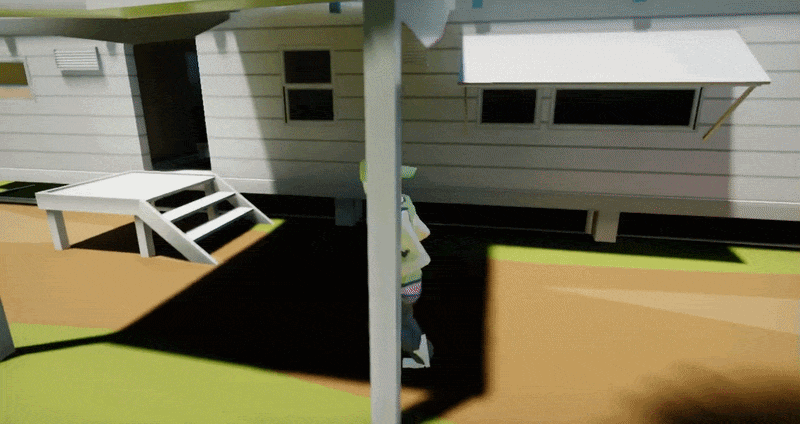

Our `DDGI` implementation for realtime Global Illumination effect got several quality and performance updates to run even better. Now, DDGI sampling and filtering in areas far from probes yield much better results with properly preserved indirect shadowing. Also, there is a new option to render DDGI indirect lighting in half-res with bilateral upscaling. See [docs to learn](../../graphics/lighting/gi/realtime.md) more about how to use it or play our [Tech Demo on Steam](https://store.steampowered.com/app/2138130/Flax_Engine__Tech_Demo_2022).

### .NET 10 and C# 14

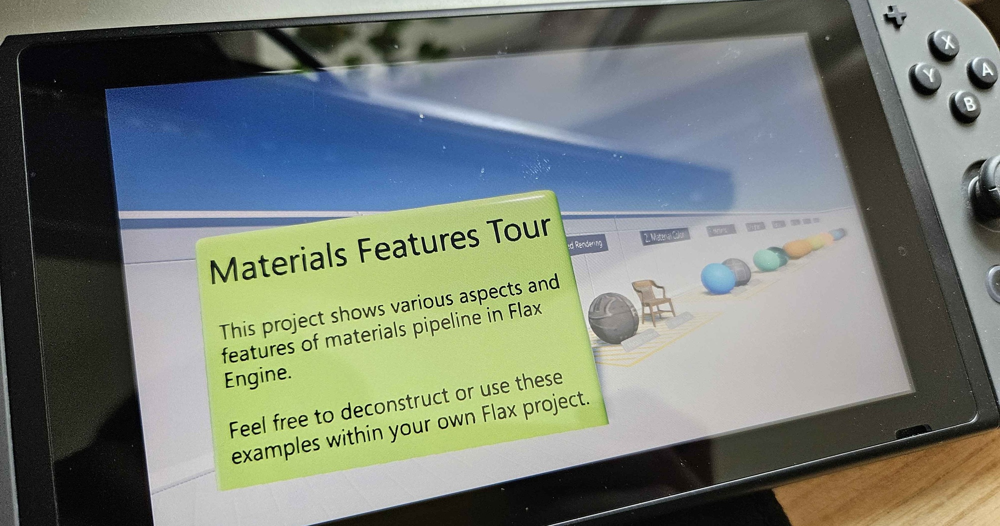

Flax utilizes the modern .NET to run C# code efficiently across the various platforms (desktop, mobile, and consoles). We’ve been supporting .NET 8, 9, and 10, but the base version was .NET 8 LTS. Since **.NET 8 reaches end-of-life support later this year, we’ve migrated to the latest .NET 10** which adds **C# 14** and major performance improvements. This version is also `Long Term Support`, meaning it will receive frequent updates and security patches over the next few years. In the picture above, you can see **Flax running with .NET 10 on Nintendo Switch**.

### PCSS Shadows

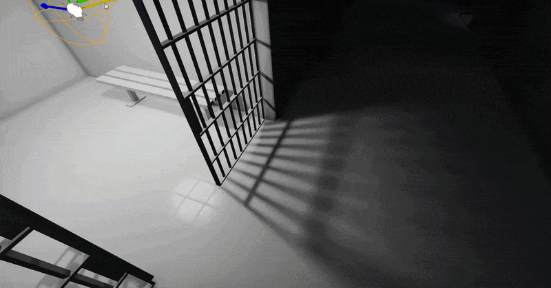

We've added a new high-quality PCSS shadow sampling algorithm with **variable-size penumbra**, which reflects **realistic-looking shadowing**. Now, the shadow penumbra adapts to the light source size and works with all light types (point, spot, directional). Altogether with DDGI, it creates believable lighting for any game type: from low-poly to high-fidelity worlds.

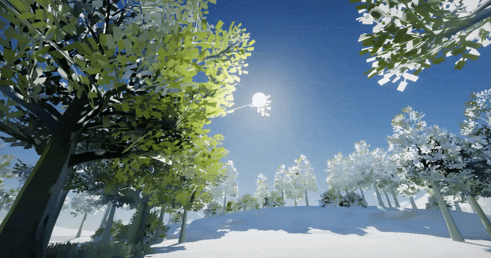

### Local Co-op with Split-screen

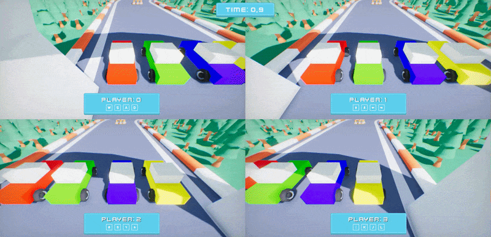

In 1.13 update, Flax allows rendering multiple viewports into the main window output with sub-rectangles for GUI. We’ve created a new sample project that showcases split-screen rendering with multiple HUDs. It's a simple local co-op racing game project available [here](https://github.com/FlaxEngine/SplitScreenSample) and based on [Arizona Framework](https://github.com/FlaxEngine/ArizonaFramework) which got proper support for multiple local players out of the box.

### DDGI Specular Reflections

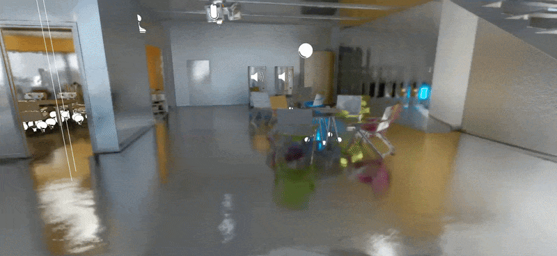

Real-time global illumination gets rough specular reflections! No need to place Environment Probes anymore. **All lighting becomes fully dynamic**. Flax already has **full-scene reflections tracing** (via our custom software ratracer based on SDFs) but only for mirror-like surfaces. Materials of higher roughness fall back to prebaked (or dynamic) Environment Probes. Now, [DDGI](../../graphics/lighting/gi/realtime.md) can allocate a new set of probes with specular:

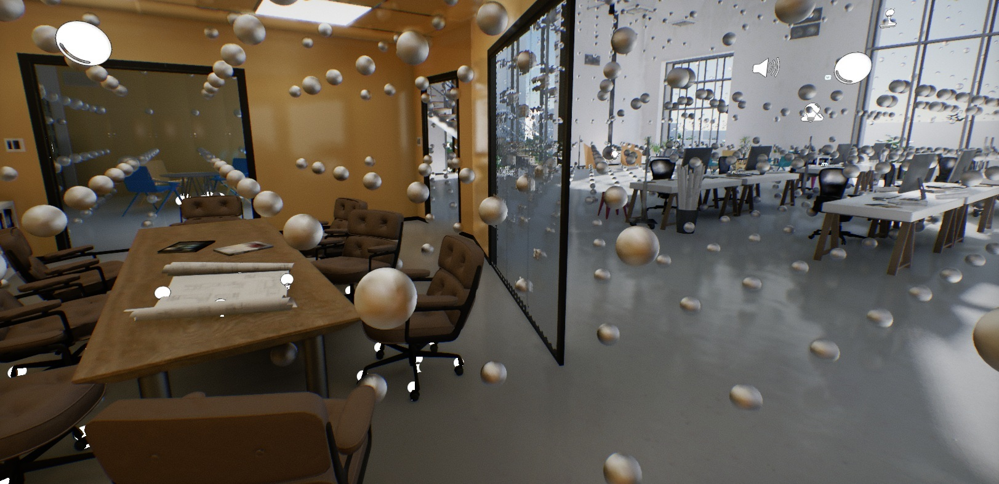

Complex scenes can have around `50,000` probes automatically placed around the camera (in cascades) and updated periodically. On presented level, effect adds `49mb` of VRAM and `0.5ms` - `0.9ms` of GPU time (on *2080Ti*). Rough reflections view:

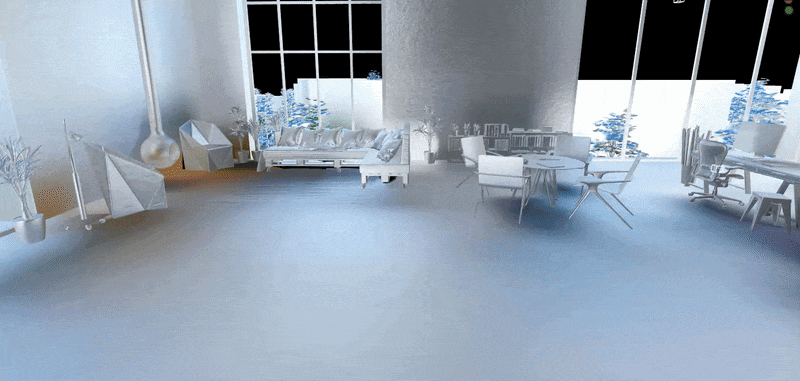

### Online Platform Sample

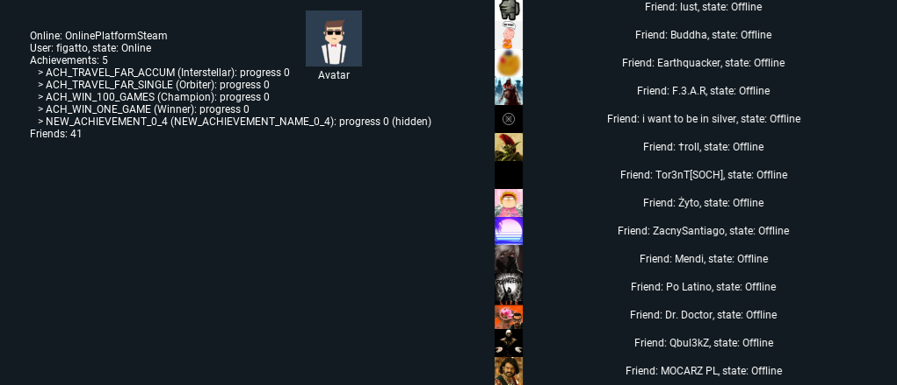

We’ve released a new simple showcase project for Online Platform usage. It's an example of how to access online player profile information, including avatar, achievements, friends list, and more (available [here](https://github.com/FlaxEngine/OnlinePlatformSample)). It uses new functionality in the `IOnlinePlatform` interface, including **user avatars**, **overlay UI**, and **rich-presence** access. The project contains Steam and Xbox Live plugins (PS4/PS5/Switch functionality is available only for registered developers).

Additionally, we’ve added new functionalities to `IOnlinePlatform` interface including: **user avatars**, **overlay UI**, and **rich-presence** access.

### Properties Panel Search

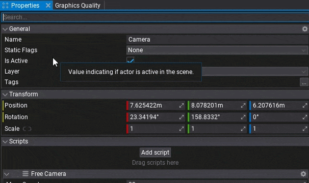

Properties panel gets a search field to boost productivity and usability! The highly awaited feature comes to Editor, including the main properties panel and the one inside prefab editor.

### Occlusion Culling

| Frustum culling only | With occlusion culling |
|--------|--------|
| 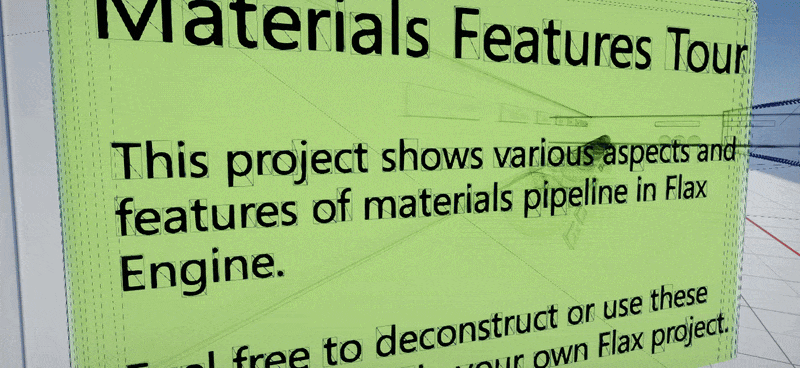 | 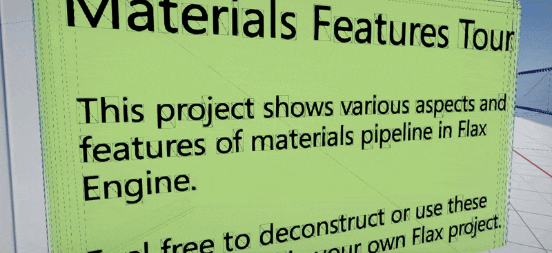 |

Finally, the occlusion culling system is coming to Flax! Now, the game can decide whether and how to cull occluded objects to reduce draw calls and improve performance, especially in interior-based games. In the videos above, you can see a before/after comparison of culling based on Hardware Occlusion Queries. It allows skipping objects occluded by others. A side effect is that it can cause some object popping artifacts, especially under heavy motion. Aside from culling based on hardware queries, we've implemented HZB-based culling, which yields more conservative results and scales better with high object counts. It works on static/animated models, particle effects, texts, terrain, foliage, and even dynamic shadows.

In the future, we plan to implement GPU-only culling with indirect drawing to skip the CPU-readback latency issue (via Two-Pass Culling). Finally, the new interface allows plugging in custom culling implementations (eg., software rasterization or even pre-baked offline).

### New Wireframe Debug View

|  |  |
|--------|--------|
| 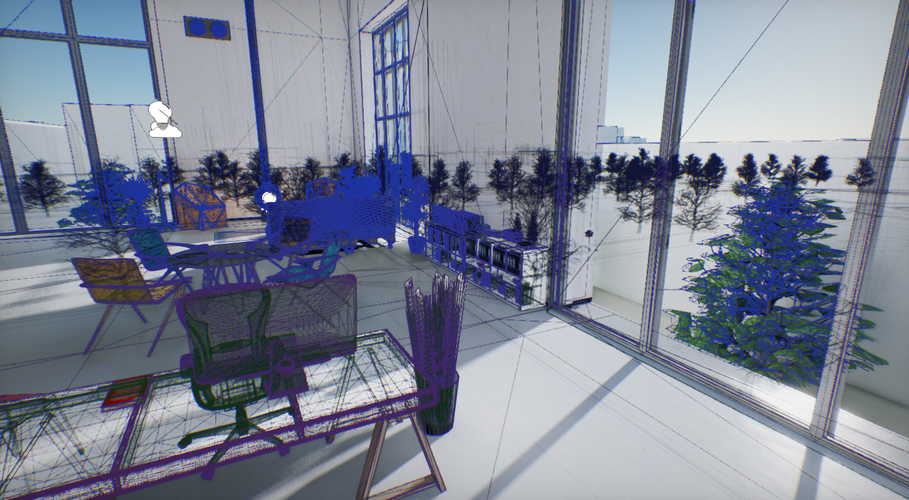 | 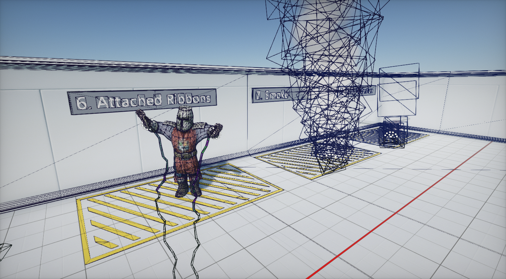 |

Old and unusable wireframe view mode got a refresh, and **now it looks good**. Wireframe lines are drawn on top of the lit viewport with a **depth-based color gradient** and **alpha-blending occluded meshes** to improve readability. This view comes in handy when profiling or inspecting level and content.

### Reversed Z

Flax rendering offers a new way of reversed depth projection that draws the scene depth buffer from `1` to `0`, instead of the typical `0` to `1`. This results in more depth precision being moved far from camera, where is usually needed, thus improving the quality of rendering large worlds. The new approach is default but can be disabled in custom engine builds. See *Migration Guide* down below to learn how this change might affect your projects.

### Audio Device Detection

On many platforms, such as Windows, Linux, Android, macOS, iOS, and Web we use `OpenAL` API to play audio. This allows us to cover a lot of systems with the same implementation code. However, on Desktop we had issues with no auto-switching the output audio device when changing it on the system. Now, if players toggle output from headphones to speakers, your game will automatically follow and redirect the output to a proper device.

### Hardware Instancing for Animated Model

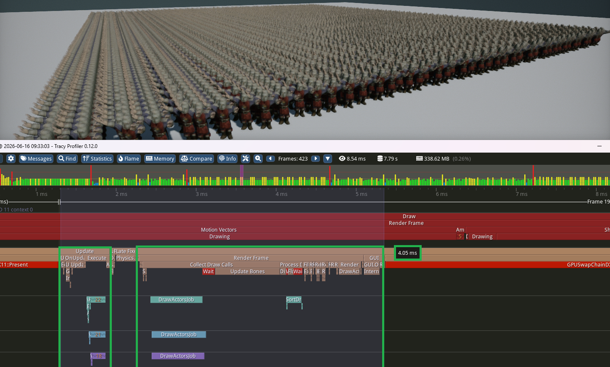

Animated Models rendering has been refactored to store their skeleton bones data inside a global shared GPU buffer. This allowed us to **batch the same skinned meshes** using the same materials to **draw at once within a single draw call**. New feature greatly improves performance and helps to scale projects made with Flax to large open-worlds. In the picture above, you can see **5,000** animated and rendered basic characters (from *Mixamo*) that run at 60fps, including per-bone motion blur and shadows (on *RTX 2080 Ti*). Instancing significantly reduces CPU overhead; in this case, **all of those models are animated and rendered within 4ms**.

### FSR 4 and TAAU

Nowadays, upscaling rendered image has become an integral part of most of the released games. While it leads to overblurry visuals with a lack of pixel-perfect sharpness, it has become a necessity in order to target higher frame rates, especially on 4K displays. Flax already offers ready-to-use [FSR](https://github.com/FlaxEngine/FidelityFX-FSR) and [DLSS](https://github.com/FlaxEngine/DLSS) plugins but we’ve added in-built support for upscaling game image during Temporal AA, which is commonly known as **Temporal Anti-Aliasing Upsampling** (**TAAU**). This method performs image upscaling while doing temporal history blending and yields acceptable results for small upscaling (eg. 80% render res). Our FSR plugin has been updated to the latest SDK version which contains **AMD FSR 4**.

Additionally, we’ve fixed global material textures mip level offset which ensures textures stay sharper when rendering image in lower resolution.

### All-Way Resizable Nodes

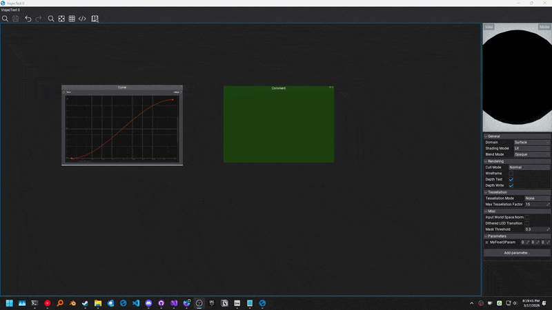

Various resizable nodes such as comments or curves can be resized from all sides now. Also, node edges highlight when a mouse cursor hovers over them to ease usage. Try it, it feels so smooth now!

### GPU Memory Profiler Update

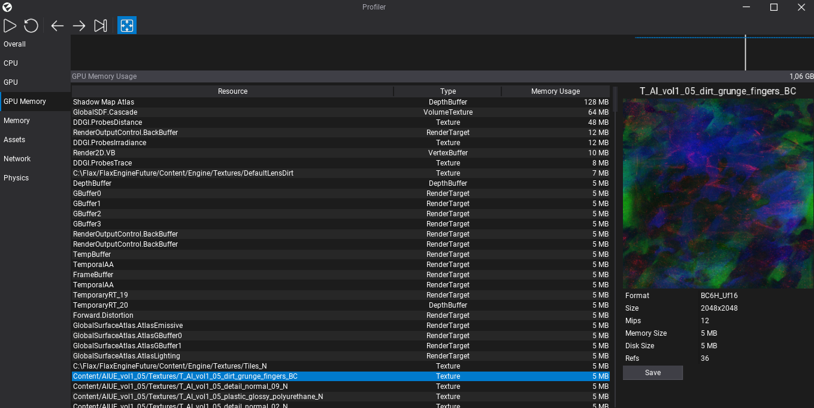

GPU Memory profiler tab can **preview selected resource** now. It displays details such as data format, resource size, or dimensions. Textures (incl. render targets) are visualized and can be saved to file with a button. Additionally, GPU resource list has been filtered to skip showing internal objects such as PSOs, constant buffers, and others that are not relevant to game developers, hence their small impact.

### Behavior Trees Improvements

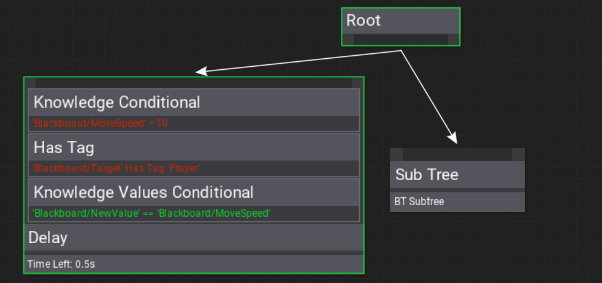

Behavior Trees editing got several significant improvements. Node decorators can **display condition debug text**, which greatly improves the readability of the logic. During play-mode those condition texts are colored based on the condition result to further improve the debugging experience. Also, decorators should match node size to reduce misplacement bugs.

### Object Interface Reference

For those who like using Object Oriented Programming with interfaces and extendable scripting, we’ve added a new utility called `ScriptingObjectInterfaceReference<T>`. It holds a reference to an object (eg. `Script` or `Actor`) which implements an interface `T`. It works in both C++ and C# code with full support for serialization, prefab references, and editor that shows an object picker in properties panel.

### UI Post Processing

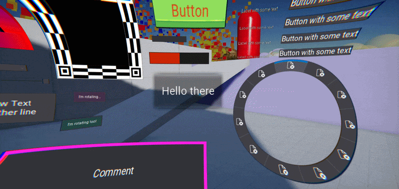

`RenderToTextureControl` draws the underlying UI structure into a texture and displays its contents instead of redrawing complex UI every frame. Now, it allows to draw a rendered UI with a custom material shader. In the shown example with some heavy distortion. It's an easy way to stylize player HUD to match the artistic vision of the game. See the dedicated [tutorial](../../ui/tutorials/create-curved-ui.md) on how to do it yourself.

### Roadmap to Flax 2.0

**Flax has been proven as a production-ready engine with released titles and an actively growing community**. Now, it's time to start planning our next steps. In August 2026, we had an open discussion on [our Discord server](https://flaxengine.com/discord) about the future and expectations of **Flax 2.0** ([link to thread](https://discord.com/channels/437989205315158016/437989205315158018/1534493407110631474)). Then we put major topics and ideas into the [roadmap card](https://trello.com/c/LRLczTAV/374-flax-20) (subject to change).
The current plan is as follows:

* Start discussions and design
* Release **Flax 1.13** (October 2026) *<- we're here now*
* Release **Flax 1.14** in Q1 2027 with:
  * New Editor Style
  * Focus on non-rendering areas (esp. UI, Input and Scripting)
  * Branch off for Flax 2.0
* Release **Flax 1.15** in Q3 2027
  * Mostly bug fixing
* Release **Flax 2.0 late 2027**

This provides about a year of ongoing updates of Flax 1 for those who want to start using it or are in active production. We aim to provide full backwards compatibility when upgrading projects to Flax 2. We invite everyone to come and join Flax Discord to be part of this discussion on `#flax-2` channel.

## Migration Guide

### From .NET 8 to .NET 10

Our policy on **.NET compatibility** is to use the current **Long Term Support (LTS) version as a base** for the engine, with an option to run on the newer .NET. For example, previous Flax 1.12 uses .NET 8, which ends its support lifecycle soon; thus, Flax 1.13 uses .NET 10 as a base (LTS for the next 2 years). This is crucial for proper support on consoles and mobile, which are less flexible in terms of new .NET updates (due to limited team resources). Now, C# 14 is supported by default, but C# projects cannot be loaded with older Visual Studio versions anymore: Microsoft's decision to use **Visual Studio 2026 for .NET 10 (and higher)**.

### Reverse Z

Switching to reversed depth buffer changes the order of values in depth buffer and projection matrix layout. Instead of going from `0` to `1`, the order is reversed to `1` to `0` - adds more precision to far distances, which improves overall rendering quality. Most materials and shaders should work out of the box, but in case of visual issues, see `Common.hlsl` header in engine to use utilities such as `DEPTH_RANGE_MIN`/`DEPTH_RANGE_MAX`/`DEPTH_CMP` in your shader code. Also, `ComparisonFunc` enum got new `Default`/`DefaultInv`/`DefaultEqual` entires that map to proper depth testing no matter the current engine config on the reversed depth. Engine can be built with `UseReverseZ` set to `false` in `Flax.flaxproj` to use the default projection.

### Vulkan Updates

We've upgraded the minimum supported Vulkan API version on several platforms:
* Windows to `1.2`,
* Android to `1.1`,
* macOS/iOS to `1.4`.

This still provides very good player support coverage and simplifies implementation and gives more room for improvements

### Scene Animation Remapping of Script IDs

We've fixed Scene Animation `Script` tracks created for prefab objects to store the script `PrefabObjectID` instead of the runtime instance `ID`. This allows `SceneAnimationPlayer.UsePrefabObjects` to remap prefab script tracks correctly when a scene animation is played on prefab instances. There is no automatic migration; thus existing Scene Animation assets that were already saved with incorrect script runtime IDs will not be fixed automatically and need to be re-authored or re-saved after retargeting the affected script tracks. [#4150](https://github.com/FlaxEngine/FlaxEngine/pull/4150)

### API Changes

* Automatic GPU Debug Layer has been disabled in `Debug` builds and can be activated manually via command line `-gpudebug` in both `Debug` and `Development` builds. `GPU_ENABLE_DIAGNOSTICS` has been renamed to `GPU_ENABLE_DEBUG_LAYER`.

## Changelog

### Version 1.13.7012.0 - 21 October 2026

Contributors: mafiesto4, lifeformed, Muzz, HydrogenC, Niko, GoaLitiuM, xrEugene, RomanZhu, Snakemonster, envision3d, xxSeys1, ThePhantomMask, Tryibion, Duroxxigar, ifromstone, jb-perrier, Alewinn-TerizKoming, luchu1993, TyGrze, ZaPx64, CodeForBeauty, DanielMacura, daveranan, Swiggies, vaibhav8a, ghueldre-pierre, Withaust, killerdevildog, fibref, vthirulo, TONYflare123, hallister, meet-brad-ch

PRs merged: 130

* Add **Hardware Occlusion Culling** to models, foliage, particles, terrain and local light shadows
* Add **HZB Occlusion Culling**
* Add more logging on GPU crash
* Add `Array` ctor from `Span`
* Add security limits for network to avoid too many messages processing
* Add option to hide debug commands (eg. one auto-added within container class)
* Add new defaults to Graphics settings to target `High` by default
* Add auto-fill to plugin project clone based on clipboard
* Add debug preview to selected resource in GPU Memory tab
* Add API to draw Skinned Model from code with Animated Model pose
* Add `FLAXENGINE_VERSION_MAJOR`/`FLAXENGINE_VERSION_MINOR` macros to shaders compilation
* Add `PostProcessEffect.CollectDrawCalls` to properly draw custom meshes
* Add temporal dithering and more accurate blending for contact shadows
* Add volume debug draw highlight to the selected env probe
* Add **Light Overlap debug view mode**
* Add `IndirectShadowsStrength` to `GI` settings for artist-controlled light leaking
* Add **NVIDIA PerfSDK plugin for Flax** Engine
* Add `Graphics.Shadows.Dump` command for profiling shadow mapping
* Add `Graphics.GI.Dump` command for profiling DDGI/GlobalSDF
* Add `Graphics.GI.GetConvergence` to use GI bounce progress for game loading screens/fades
* Add new **DDGI Reflections rendering** mode for **fully dynamic indirect specular**
* Add `CanBuild` to target for selective project references compilation
* Add `GIProbesSpacing` and `GlobalSurfaceAtlasResolution` to global `Graphics` for runtime editing
* Add noise to Global SDF and Surface Atlas debug preview to smooth the tracing
* Add Global SDF dynamic chunks updates between full cascade updates to hide latency on fast moving objects
* Add new `Lighting` debug view mode for both diffuse and specular lighting preview without material colors
* Add option to render DDGI indirect lighting in half-res with bilateral upscaling
* Add zooming in and out (FOV) in editor viewport using `C` and `Z` keys
* Add support for Windows 11 SDK version `28000`
* Add auto focus on model when changing Base Model in Anim Graph
* Add direction gizmo rotation while holding right mouse button
* Add help support to Debug Commands via XML docs parsing
* Add client-side window decorations support for macOS editor windows
* Add `MacWindow` logo loading and use correct one for Editor
* Add Volume to audio clip import options
* Add material instance creation out of other instance
* Add filtering whitespaces to Xml doc comments of type members and optimize filtering
* Add type picker when creating abstract class or interface
* Add cross button to unset abstract class or interface object value
* Add layers settings shortcut to actor layer dropdown
* Add support for building Android targets from macOS
* Add navigation to Slider control
* Add `Create Prefab Variant` option to Prefab asset context menu
* Add utility UI Control spawn menu inside scene/prefab context-menu
* Add middle and right mouse button actions to asset/object pickers to clear value or show popup quickly
* Add shortcut to show editor windows content (`Ctrl + 0`)
* Add max .NET version to 11
* Add hiding tooltips when mouse buttons are pressed
* Add custom **animation inputs to Multi Blend nodes**
* Add improved tooltips to Visual Script types with file name
* Add auto-scroll the Content Window navigation bar to the current folder
* Add grey display for deprecated enum options
* Add improved Rider projects C++ preprocessor definitions (Linux/macOS)
* Add new `ScriptingObjectInterfaceReference` to reference object with interface
* Add rich text formatting to Debug Log title messages
* Add `Start`/`EndTextInput` for control to toggle character input events
* Add MSDF font enhancement (eg. shared size per-asset)
* Add **word wrap support to Rich Text Box**
* Add various improvements to CSG Brushes editing workflow
* Add more useful titles for BT decorator nodes
* Add red/green highlights to debug BT node decorator result
* Add editable keyframe proxies for linear and bezier curve editors, including time/frame fields and curve values
* Add tangent editing support for bezier curve keyframes in the keyframe edit popup
* Add curve keyframe edit popup draggable so it can be moved away from the curve view
* Add **CLion support** (via CMake project files)
* Add option when entering play mode to always restore to the editor window after exiting play mode
* Add auto-select of newly copied/moved content items
* Add `CHECK_NO_RETURN` for checks in code that should continue function execution
* Add `VariantType::GetScriptingType` for easier type information access
* Add simpler `Variant::Enum` that auto-setups variant type from enum scripting info
* Add more LOD Generation options to model import settings (eg. borders lock, preserve UVs)
* Add `Physics::DeleteScene`
* Add **properties search field**
* Add distance-scale to vertex paint vertices
* Add vertex paint brush size changing with shift+scroll
* Add improvements to Gameplay Globals editing
* Add auto-renaming newly added Visject parameters
* Add **Texture and Cube Texture support to Gameplay Globals**
* Add `RealtimeSkybox` mode to `SkyLight` for dynamic skylight
* Add ` Brightness`, `ResolusionScale`, `DebugView`, and `LayerMask` to viewport persistence
* Add Video playback value on Video Player
* Add way to get blackboard by type
* Add `AGENTS.md` file (to Engine repo)
* Add auto scroll to new track when adding track to animation
* Add groups to Animated Model properties and improve skeleton debug drawing
* Add GetValue by type in c# for gameplay globals
* Add `Escape` key to deselect in Editor
* Add `VersionControlInfo` to output game build info and log game version with branch/commit info
* Add `D3D12MemoryAllocator` for resource allocations on DX12
* Add `GPUMemoryStats` for GPU video memory stats
* Add `GPUDrawPass` for more efficient render attachments setup
* Add detecting Vulkan SDK version in build tool
* Add scalability via AA Quality setting for TAA
* Add **realistic soft shadows on Ultra quality** with `PCSS` filter
* Add `SourceAngle` property to Directional light that controls PCSS penumbra size
* Add highlight to Motion Vectors Debug view for better content optimizing
* Add `Optimization` sub-group in view modes list in Editor Viewport
* Add VSync support to Vulkan
* Add support for loading custom mouse cursor images
* Add support for using macros in scripting function parameter default values
* Add `GetTextureData` function to texture API in C#
* Add 'GPUBuffer' parameter type to materials and particles
* Add rendering stats for Data Upload
* Add **Reversed Z rendering** for higher depth buffer precision in open-worlds
* Add in-built editors for `DateTime` and `TimeSpan`
* Add `ShowInPlayMode` to `HideInEditor` attribute for properties/fields that should display in editor only during play mode
* Add new `Level.PreloadSceneAsync` for streaming levels before they need to be loaded in
* Add debug prints for logs init for console issues troubleshooting
* Add missing serialization and empty ctor to `CultureInfo`
* Add `EditorUtilities::GetSDK` to query SDKs via `Flax.Build` from editor
* Add `FromMemory` and `LoadMemory` to `Texture` for loading images from memory
* Add `GetUserAvarar` to Online Platform interface
* Add **rich-presence to Online Platform interface (status text and game id)**
* Add game overlay UI utilities to Online Platform interface
* Add online platform implementation for **PSN on PS5**
* Add GDK manifest localization to fix packaging issue
* Add half-res DDGI reflections resolving to optimize rendering on low-end devices
* Add Global SDF trace step scale for SSR reflections to handle SSR Quality
* Add `ViewportRect` to `Camera` and rendering for split-screen drawing
* Add `ViewportRect` to `UICanvas` for UI placement
* Add `InputLatencyMs` stat to `ProfilingTools`
* Add `Loaded` event to `Asset` in scripting
* Add `BoundingSphere.Transform` with `Transform` instead of `Matrix`
* Add `GPUQueryType::BinaryOcclusion` for simpler visibility checks
* Add `MaterialTextureMipBias` to control texture mip bias in materials for better frame upscaling
* Add new **temporal upsampling option (TAAU)** when using location `DuringAntiAliasing`
* Add new FSR 4.1 plugin update (SDK 2.3)
* Add `Graphics::MotionVectors::MinObjectScreenSize` to skip too small objects from drawing motion vectors
* Add mesh index buffer optimization based on `meshoptimizer` library
* Add Global SDF Overdraw debug mode for content optimizations
* Add improvements to  DDGI sampling and filtering in areas far from probes
* Add improved fallback GI outside the DDGI range to use a special ambient probe for stability
* Add `CascadeBlendSize` to Directional Light
* Add `DefaultProbeCubemapFormat` to Graphics Settings with option to compress env probe textures
* Add `MeshAccessor.LoadBuffer` with format for Index Buffers
* Add **Temporal Antialiasing as default AA method**
* Add selection drawing and picking gizmo to Foliage Types editing tab
* Add audio device change detection in OpenAL backend
* Add `ExpandChildSize` option to vertical/horizontal panels to resize child controls to fill the panel size
* Add `DrawMaterial` feature to `RenderToTextureControl` for custom post-processing the cached UI image
* Add `ConstantInvalidate` option to `RenderToTextureControl` for no-cached image
* Add `Bypass` feature to `RenderToTextureControl` to skip rendering cached image
* Disable Motion Blur and Eye Adaptation by default
* Deprecate the `Direction` actor property and replace with `Forward`
* Remove deprecated `UWP` platform from Game Cooker window
* Rename `SceneRenderTask::RenderingPercentage` to `RenderScale`
* Rename Sphere Mask node A and B inputs to be more clear what they do
* Rename Actor bounding box and sphere properties to be more verbose with `Bounding` prefix
* Rename `BRDF` visibility functions prefix to `V_` from `Vis_`
* Change default for showing Debug Draw in game window
* Optimize XML documentation reference parsing and overall performance
* Optimize model actors entries serialization
* Optimize auto generated Variant Types in bindings to reduce dynamic memory allocs in game builds
* Optimize dirty shadow bounds update for particles and foliage
* Optimize Vulkan texture clears with render pass attachments clear operation
* Optimize Vulkan render passes with a new `GPUDrawPass` to manually control attachment operations in higher-level API
* Optimize various rendering effects with `GPUDrawPass`
* Optimize GPU memory allocations on D3D12 with `D3D12MemoryAllocator`
* Optimize foliage serialization by batching instance data, performing quantization, and LZ4 compression
* Optimize first scene startup by preloading it during loading screen
* Optimize content modifications watching events processing in large projects
* Optimize CPU rendering of shadowed foliage by splitting draw contexts into separate async jobs
* Optimize foliage instance bounds calculations
* Optimize `FoliageInstance` size to cut down memory by and reduce cache misses when drawing foliage
* Optimize foliage rendering with less cache misses
* Optimize foliage drawing by caching per-instance world matrix
* Optimize large scene files loading by aligning json pool allocator pages to 64kB
* Optimize large scene/prefa/json assets metadata loading by avoiding parsing full contents
* Optimize draw calls batching and instancing with better sort keys generation and processing
* Optimize shadows and depth rendering with instancing support for transparent shaders
* Optimize `LightmapUVs` to be stored already as `Half4` to avoid runtime conversions during rendering
* Optimize scene rendering loop performance
* Optimize Global Surface Atlas to cache objects shader data
* Optimize Global Surface Atlas updates distribution for subobjects (eg. foliage instances)
* Optimize Global Surface Atlas with object draws limit per frame
* Optimize Global Surface Atlas defragmentation with copying old atlas to avoid redrawing all objects
* Optimize Global Surface Atlas full direct lighting redraw to copy whole emissive atlas at once
* Optimize basic `Mathf` function to use more inlining
* Optimize `Mathf` to use `float` versions of intrinsic
* Optimize **Animated Model rendering with hardware instancing**
* Optimize animated model startup to avoid double init of the bones buffer and pose
* Optimize resizing dictionary to add new unique keys faster for primitive and `int` values
* Optimize DDGI probes debug with a batched instanced draw
* Optimize DDGI indirect lighting resolving to use depth bounds test
* Optimize rendering when using TAA to draw PostFX directly to backbuffer
* Optimize development-only shaders and rendering code to compile it out in Release game builds
* Refactor `BRDF` roughness input to be squared
* Refactor Temporal Anti-Aliasing shader to have less ghosting and quality scalability
* Refactor `RenderingUpscaleLocation` enum item names
* Refactor `Wireframe` view mode to draw wireframe on top of lit view
* Refactor `Asset` events naming to match engine scheme
* Refactor `CommandLine` parsing and processing
* Refactor `GeometryDrawStateData` storage into `RenderBufers` for correct split-screen rendering
* Refactor `ISceneRenderingListener` events to contain more data
* Refactor rendering code by moving `RenderContext` to a separate harder file
* Refactor `Actor::Draw` to use only variant with `RenderContextBatch` to simplify rendering code
* Refactor `NetworkMessage` and `NetworkStream` to handle errors gracefully, including in Release builds
* Refactor engine shaders folder to have better organization
* Refactor `OnlinePlatformXboxLive` and `OnlinePlatformSteam` into shared `FlaxEngine.Online` namespace
* **Update to .NET 10**
* Update `LZ4` library to `v1.10`
* Update to the latest Vulkan SDK `1.4.350`
* Update Vulkan API to `1.2` on Windows
* Update Vulkan API to `1.1` on Android
* Update Vulkan API to `1.4` on macOS and iOS
* Update `DirectX12Agility` to `1.619.3`
* Update `DirectXShaderCompiler` to `1.9.2602`
* Update actor `LookingAt` to be a more descriptive name
* Fix deprecated flag usage when loading scenes over multiple frames
* Fix loading `SceneReference` property in Visual Script
* Fix Global Surface Atlas rasterization of objects with negative scale
* Fix Global Surface Atlas tiles padding and position precision to have proper stability
* Fix DDGI sampling when using non-directional lighting (eg. smoke particles or volumetric fog)
* Fix default shadow depth bias values and control them based on shadow resolution/quality mix
* Fix Directional Light fade at distance
* Fix Directional Light rendering to be skipped when color alpha is zero
* Fix `Guid` diff serialization and loading invalid values
* Fix editing flag enum to properly toggle bits incl. bit masks
* Fix missing SDK print for ones from modules or plugins
* Fix editing array of `CultureInfo` values
* Fix `ForDistribution` build option to not be explicitly enabled in `Release` builds
* Fix various shader warnings
* Fix UI double-click actions to work only with left mouse button
* Fix editor fonts resolution scale on High DPI screens
* Fix main camera by proper active cameras list ordering
* Fix delay on virtual GPU texture upload to be immediate
* Fix Quad Overdraw pass to skip draws from materials that don't support it
* Fix `CanvasScaler` point projection when using location offset
* Fix for flickering tree structures on expand/collapse
* Fix Windows SDKs and Toolsets log from build tool to be sorted descending by version
* Fix compiling project with plugins for Web
* Fix project version control info for empty `.git` repo
* Fix Global Surface Atlas sampling sub-texel error
* Fix self-shadowing artifacts in DDGI on fast moving objects
* Fix DDGI/SDF quality in editor view when moving static objects around
* Fix Debug Draw shapes manual depth test when using resolution upscaling
* Fix various rendering elements when using upscaling
* Fix using `Tools` menu without Game Settings asset
* Fix custom draw calls submission within post-process callback
* Fix Global Surface Atlas with large worlds
* Fix height fog density calculation with large worlds
* Fix warnings when running on `null` renderer
* Fix rendering transparent material on WebGPU without shadows
* Fix occlusion queries on WebGPU and Vulkan
* Fix missing network messages reading init to avoid crashes on incorrect message
* Fix various edge-cases in network replication system to avoid crashes
* Fix dangling replication queue items and parts after client disconnected
* Fix saving virtual Material Instance asset
* Fix safety of the network handshake and C# network stream
* Fix `ENet` packet leak after receive event
* Fix `ENet` network driver to use 3 separate channels for different packet types
* Fix `ENet` network driver stats from all peers
* Fix assertion on shader load failure
* Fix missing `Int2`/`Int3`/`Int4` in `Variant` support implementation parts
* Fix Rider detection on macOS when installed in the user Applications folder
* Fix Vulkan Tracy timestamp queries on MoltenVK
* Fix macOS popup/tooltip windows handling
* Fix drag&drop on X11 Linux with SDL
* Fix mouse position in events reported from caption area on Windows
* Fix window decoration buttons not clickable with DPI scale
* Fix property get/set function name length in dotnet bindings
* Fix output log history popup management to smoother usage
* Fix `MeshAccessor` triangle count calculation bug
* Fix Variant static typenames caching bug in Editor
* Fix asset 'Reload' option to be available when asset failed to load for manual load
* Fix asset storage handling when file is locked
* Fix asset cache eviction for locked files to retain cached info
* Fix reloading assets that failed to load
* Fix dirtying scenes after building navmesh in Editor
* Fix scene texture node with `WorldPosition`
* Fix model material access with empty entries
* Fix Web build when python is installed in folder with whitespaces in path
* Fix building deps for Windows ARM64
* Fix UI focus entries list when opening import files dialog
* Fix auto-selecting newly imported or created assets in Editor
* Fix prefab Script track IDs for Scene Animation remapping
* Fix vertex paint brush size to match the highlight sphere
* Fix Editor Grid jitter after TAA resolve
* Fix `ProgressBar` fill with large margin
* Fix spline editing in Large Worlds
* Fix alternating table row coloring
* Fix Render2D line thickness scaling
* Fix procedural Skinned Mesh creation from code
* Fix t-posing when Multi Blend 2D when one of the triangulated point animations is empty or loading
* Fix timeline curve expanding to properly show whole curve area
* Fix GUI blur panel to respect input image alpha
* Fix Camera Space canvas rendering to properly clip viewport
* Fix collapsed curve keyframes display bug
* Fix mesh vertices deduplication to use relative error, not fixed value
* Fix Large World offset bug in triplanar texture nodes
* Fix eye adaptation to be turned off in editor asset previews
* Fix shader error when using non-ASCII characters in material
* Fix importing skinned models with multiple LODs
* Fix text box highlighting not using DPI
* Fix material drag over highlights to not flicker
* Fix missing distortion rendering on Deformable materials
* Fix missing treeview folder shortcuts
* Fix project generation when configuration/platform is unsupported
* Fix Editor toolbar to exclude project path but only name
* Fix dynamic C# scripting features in Editor by preloading stdlib assembly
* Fix indexed properties from displaying in Editor (throws exception)
* Fix terrain resolution in editor
* Fix terrain collision leftover when destroyed manually
* Fix terrain patch add mode not picking patches in scaled terrain
* Fix game window resize to maintain placement within screen (eg. centered)
* Fix game window resolution when resizing during fullscreen on Windows
* Fix game window to maintain resolution and be centered when going out the fullscreen on Windows
* Fix window layout when changing System DPI on Windows
* Fix infinite grid actually infinite
* Fix mesh index buffer when using 32-bit indices
* Fix content browser stealing focus from popup asset windows on SDL
* Fix Wayland window not getting attached to the drag operation
* Fix Vulkan swapchain surface to be preserved during resize
* Fix the release of Vulkan samplers
* Fix `NodesCache` desync after hot-reload in Editor
* Fix C# std lib detection due to `RepositoryUrl` change
* Fix nested prefab stack overflow when adding new object to nested prefabs hierarchy
* Fix nested prefab stack overflow when applying changes with animated models inside hierarchy
* Fix CSG Brush face moving bugs
* Fix mesh collider updates after recooking collision data
* Fix curve track right-drag panning responsiveness
* Fix curve track resize handling
* Fix Scene Animation preview playback controls and time comparison behavior
* Fix scripts/content files getting deleted after file modifications
* Fix scripting assembly file loading when file is locked
* Fix Editor's Game window minor stability issues
* Fix Editor windows order when restoring after scripts reload
* Fix floating editor window ordering and focus restoration on macOS
* Fix default value in Editor when it's `null` for value-type
* Fix GUI traversal during child removal
* Fix streaming of wide/tall textures
* Fix discarding unsaved asset editor changes
* Fix Roslyn analyzer include resolution
* Fix using `NuGet` package with different dependencies
* Fix Game Cooker wait on code compile/load end before cooking starts
* Fix `ParseFloat` rejecting a '+' sign in the exponent
* Fix slider control with negative minimum range value
* Fix spawning actors in viewport to have better origin placement
* Fix animation slot bugs and stabilize scripting playback
* Fix BT node size when renaming decorator
* Fix bug in BT sub tree knowledge type validation
* Fix C# 'IsByRefLike' types that cannot be created on heap
* Fix `In`/`Out` attribute warning in generated bindings for boolean arrays
* Fix Multi Blend animations reversed playback when using negative speed
* Fix missing mutex lock in Game Cooker thread
* Fix Wayland dragging events racing with SDL data offers- #4279
* Fix crash in scripting bindings when unboxing `null` class
* Fix crash on custom Assimp logger
* Fix crash on headless Editor game run
* Fix crash on inactive DDGI probes on 1st frame
* Fix crash on D3D11 init with debug when Direct3D debug layer is missing
* Fix crash when looping BT with Force Success node
* Fix crash when loading invalid `VisjectMeta`
* Fix crash when using curves inside Anim Graph
* Fix crash when encoding CJK characters from UTF-16  into UTF-8
* Fix crash when `GPUBuffer` creation fails on D3D11
* Fix crash when skeleton node has invalid binding in Animated Model pose
* Fix crash `StringUtils::Copy` on Win32 when length is zero
* Fix crash on D3D11 draw without valid state set
* Fix crash on too long path on Unix
* Fix crash when reading process output on Windows with an empty data
* Fix crash when calling `DebugCommands` from async threads
* Fix crash when using `WheeledVehicle` as player pawn in Arizona Framework
* Fix crash on invalid Multi Blend 1D indices
